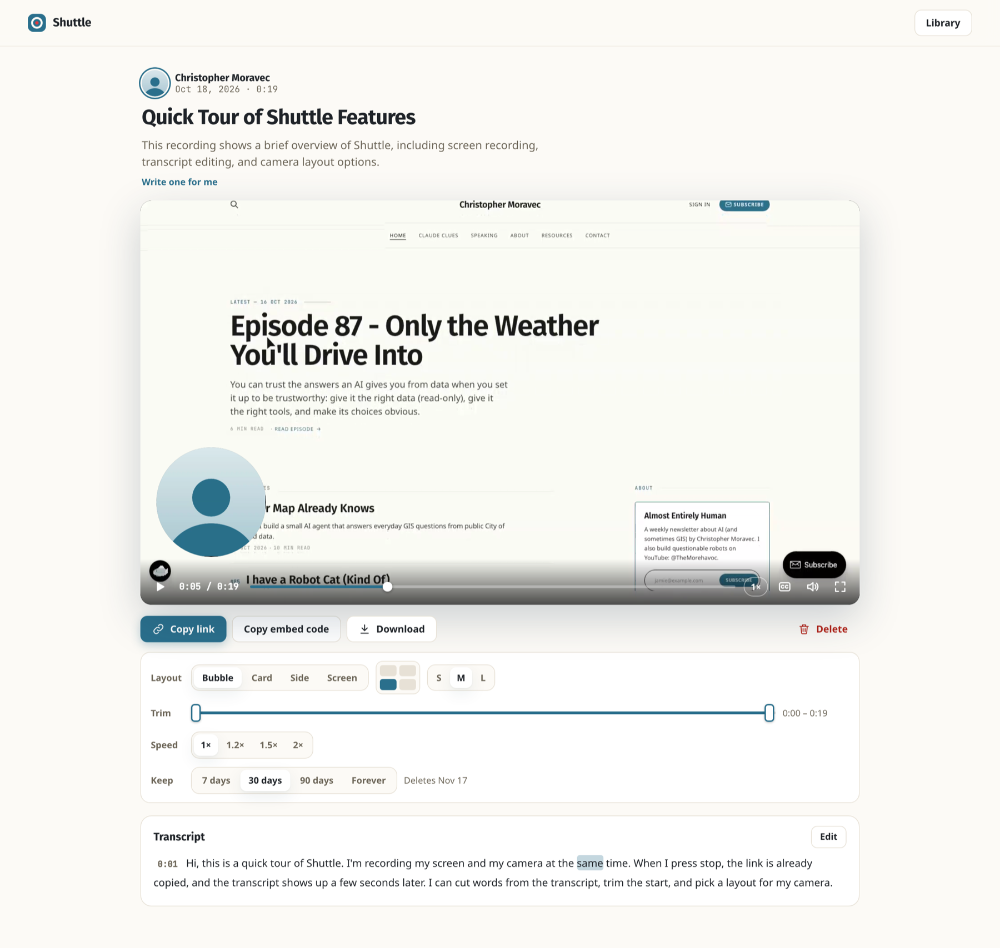
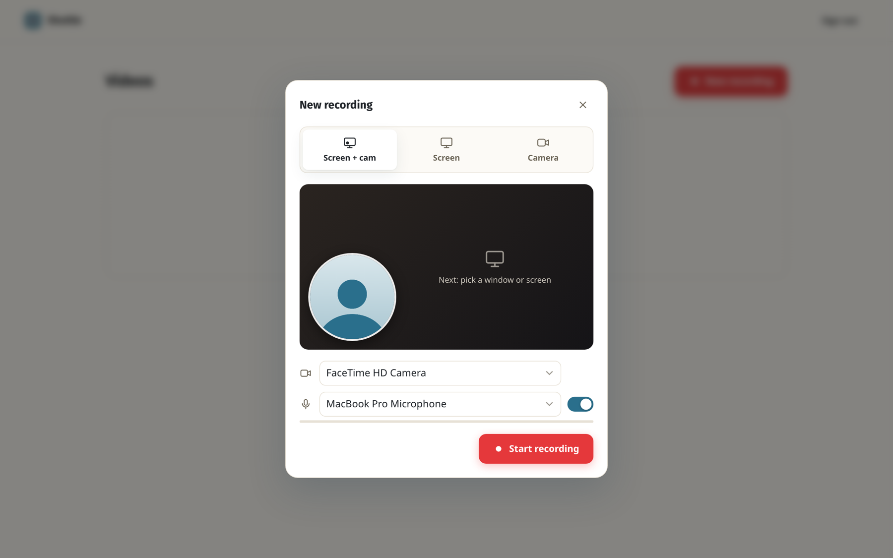
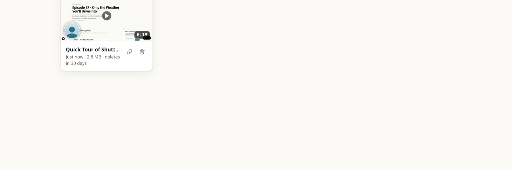
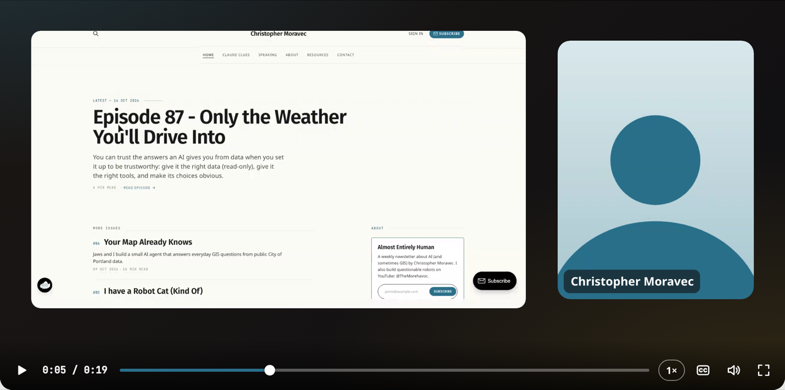
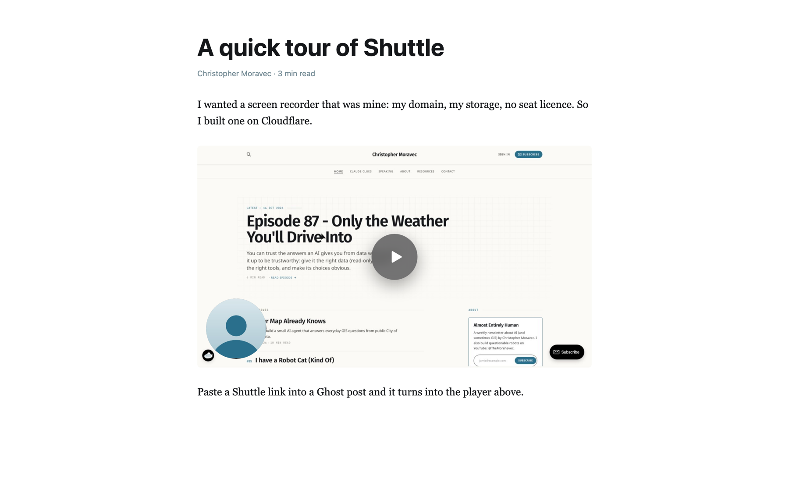
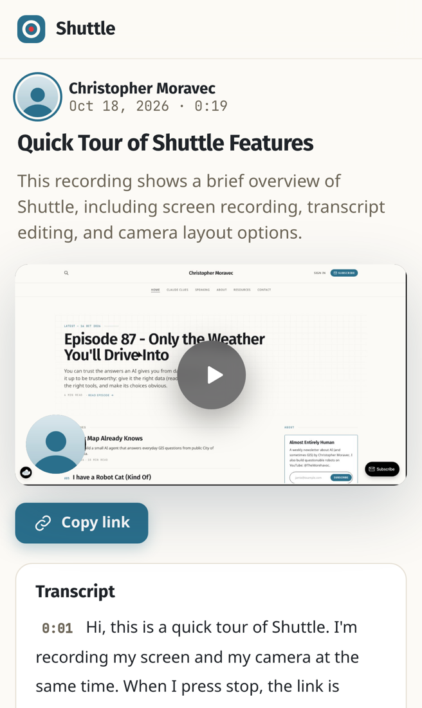

# Shuttle

Record your screen and camera, get a link. Styled after christophermoravec.com (teal on warm paper, Fira Sans / Noto Sans). A small Loom clone on Cloudflare: one Worker, an R2 bucket for video, a D1 database for metadata, Workers AI for transcripts. No build step. MIT licensed.



<table>
<tr>
<td width="50%"><br><sub>Pick what to record, check your camera and mic.</sub></td>
<td width="50%"><br><sub>Your library: every recording with its length, size and expiry.</sub></td>
</tr>
<tr>
<td><br><sub>Layouts are chosen after recording. This is Side.</sub></td>
<td><br><sub>Paste a link into Ghost (or anything that speaks oEmbed) and it embeds.</sub></td>
</tr>
</table>

<p align="center"><br><sub>The share page on a phone.</sub></p>

Screenshots come from a real recording on a local server, made by `scripts/readme-shots.mjs` (the camera is a drawn stand-in).

## What it does

- **Three modes:** screen + camera, screen only, camera only. Mic and tab/system audio are mixed in. **Start recording** waits until the camera is live and says so while it starts.
- **Phones too.** iPhone Safari (iOS 27 and later) records the screen and the camera; an older phone records the camera only and says why. On a touch screen the recording bar is one full-width row of big labelled buttons, with Delete well away from Stop. iPhone Safari pauses the camera while another app is in front; the sound keeps recording.
- **The camera is its own recording.** Screen + camera records two files side by side: the screen (with all the audio) and the camera. The share page composites them, so the camera never depends on a floating window being captured.
- **Layouts**, picked per video on the share page and remembered for the next one: **Bubble** (round, any corner, S/M/L), **Card** (rounded portrait), **Side** (screen framed, camera beside it) and **Screen** (no camera; viewers can't fetch the camera file, its thumbnail or a preview with your face).
- **Floating bubble** while recording: a self-view (Document Picture-in-Picture in Chrome/Edge, video PiP in Safari) with timer, pause, stop and delete. For a window or tab share it stays up. For a whole-screen share it closes when recording starts, and the on-page preview is hidden, so you aren't recorded twice.
- **Instant link.** Both files upload in 5 MiB parts *while* you record. Stop copies the link and opens the share page a few seconds later.
- **Fast start.** Browsers record MP4 as a chain of one-second fragments with no table of contents, so Chrome walks the whole chain before it plays or seeks. After Stop the server writes a fragment index (`sidx`, about 2 KB for 3 minutes) and splices it in front of the fragments as the file is served; the stored file never changes. "Complete" waits for it (up to 15 s), so the share page you land on starts at once, and each page keeps asking for the file the way it first got it (`?ix=0/1`), so an index that lands later never moves bytes under a playing video.
- **Transcript** while you record: the audio is cut into half-minute chunks at quiet moments and transcribed as it goes. Chunk positions are measured against the recording, and word edges next to pauses are snapped to the audio.
- **Description:** once the transcript is done, a title (only if you haven't renamed it) and a one- or two-sentence description are drafted for you; edit either in place, or **Write one for me** again. Your own text is never overwritten.
- **Expiry:** each video keeps 7, 30 or 90 days, or forever (new recordings use your last choice; 30 days to start). Expired videos disappear at once and are deleted by an hourly cron (`[triggers]` in `wrangler.toml`; a second one, every 5 minutes, finishes viewers' copies of edited videos).
- **Editing from the transcript** (owner): select words and cut them, **Remove ums**, **Shorten pauses** (pauses of 1–8 s; a longer silence is usually you showing something), undo, restore all. Captions come from the same words.
- **Trim** (owner): two handles set where the video starts and stops; the player shows the frame under the handle while you drag. The trim is stored apart from the cuts (neither swallows the other), and its end means "from here on" whatever length a browser reads the file to be. The transcript (trimmed words are dimmed), Undo in its Edit mode, viewers and the edited download follow it; **Reset** takes it off and leaves the cuts. **Shorten pauses** stops at the trim, so taking the trim off brings back everything it hid.
- **Share page** at `/v/<id>`. It has:
  - link-preview tags;
  - speed (1×–2×), captions, keyboard shortcuts;
  - a transcript that jumps on click;
  - for the owner: rename, delete, layout and **Download** (screen and camera files).

  Viewers get no download button and never receive cut words.
- **Embeds.** `/e/<id>` is the player alone, the only page another site may frame. The share page advertises an [oEmbed](https://oembed.com) endpoint (`/oembed?url=…`), so pasting a link into Ghost, WordPress or Notion turns it into the player. The owner's **Copy embed code** gives the `<iframe>` for an HTML card.
- **Failure handling:**
  - A dropped connection pauses the upload and resumes it.
  - A server refusal shows up while you're still recording.
  - **Download copy** saves the local recording when an upload fails.
  - A recording interrupted by a closed tab can be **recovered** from the parts that already uploaded.
  - Transcript chunks that never arrived show as gaps, not as a finished transcript.

Links are public by unguessable id (12 characters, about 70 bits). Everything else needs the owner password.

**What "cut" and "trim" mean:** you (the owner) keep the whole recording; your player skips the edits, and Undo can bring anything back. Viewers get a separate copy with the edited-out parts taken out of the file, so a share link (or `/raw/<id>`) never hands out what you cut. The server builds the copy in the background a few seconds after an edit (no re-encoding: it copies what it keeps). Until it is ready, viewers see "Updating this video…", never the original; the owner's page shows its state under **Shared**. Sound is cut to about 20 ms. Video can only restart on a key frame, so after a cut the picture holds still for up to a second while the sound plays, and a trimmed start moves on to the next key frame (up to a second more is trimmed). The recorder asks for a key frame every second; recordings made before that may have them several seconds apart in Chrome, which makes those holds longer. A recording the server can't cut this way (WebM from Firefox, say) is marked so on the owner's page, and its viewers get the whole file with the edits skipped, as before. A start trim takes the poster and the link-preview picture again from the new start, but a preview already shown in a chat keeps the old picture. The description drafted from the transcript is written before any edits; reread it if you cut something it might mention.

## Deploy

Deploys run only through GitHub Actions (`.github/workflows/deploy.yml`). The workflow creates the R2 bucket and the D1 database if they're missing, applies migrations, deploys, sets secrets and checks `/api/me`. Add three repo secrets:

| Secret | Value |
|---|---|
| `CLOUDFLARE_API_TOKEN` | Account token: Workers Scripts Edit, Workers R2 Storage Edit, D1 Edit. If the deploy fails on the `AI` binding, add Workers AI Read. |
| `CLOUDFLARE_ACCOUNT_ID` | Your account id |
| `OWNER_PASSWORD` | The password you sign in with |
| `SHUTTLE_DOMAIN` | Optional. A hostname like `videos.example.com` (see below) |

Then push to `main`, or go to **Actions → Deploy → Run workflow**. Until the secrets exist, the workflow runs the tests and skips the deploy. `SESSION_SECRET` is generated on the first deploy. The app answers at `https://shuttle.<your-subdomain>.workers.dev`. To serve it on your own hostname, add a fourth secret, `SHUTTLE_DOMAIN` (for example `videos.example.com`, no `https://`). The deploy adds it as a Workers Custom Domain, and Cloudflare creates the DNS record and certificate. The hostname's zone must be on the same Cloudflare account and must not already have a CNAME for it. Give the token zone access for that zone (Workers Routes Edit, DNS Edit, Zone Read). The `workers.dev` address keeps working too. Deleting the secret later doesn't detach the domain; remove it in the dashboard under the Worker's Domains & Routes.

**Signing in.** Only Shuttle's own page can try a password (another site posting wrong ones from your browser can't lock you out). Each address gets 10 tries per 15 minutes; an IPv6 address counts as its whole /64. While more than 100 tries an hour fail, each address gets 3. Past 300 an hour, only a browser that has signed in before gets to try, so yours still works and a guesser's doesn't. Use a long random `OWNER_PASSWORD` all the same. Changing it signs every browser out.

**Costs and limits.**
- R2 gives 10 GB free, about 6 hours of 1080p screen recording at 3.5 Mbps; the camera file adds about a third. Egress is free.
- Transcripts use `@cf/openai/whisper-large-v3-turbo`, run twice per half-minute chunk. One run is prompted to keep "um"s and one is plain, and the plain one guards against the prompted one inventing text. That is a fraction of a cent per recorded minute.
- Each chunk takes roughly 10 ms of Worker CPU. The Free plan's 10 ms limit can cut that off, which leaves a chunk *failed* (Retry on the share page). Workers Paid doesn't have the problem.

## Develop

```sh
npm install
printf 'OWNER_PASSWORD=dev\n' > .dev.vars        # add OPENAI_API_KEY=… for local transcripts
npm run dev                                       # migrations + wrangler dev --env local
```

`--env local` has no Workers AI binding, so local runs never touch a Cloudflare account. Locally, transcripts come from OpenAI `whisper-1` if `OPENAI_API_KEY` is set. With no provider at all, the audio is kept and can be transcribed later. Safari keeps `Secure` cookies only over HTTPS, so test Safari through `wrangler dev --local-protocol https`.

## Tests

- `npm test` runs:
  - the timeline maths (19 checks);
  - the transcript post-processing (17);
  - the fragment index on hostile files (12);
  - the viewers' copy of an edited video (25): every frame and every bit of sound in the test recordings says when it was recorded, so decoding a copy shows that nothing from inside a cut is in it, that it stays in sync, and how damaged or cut-off files are handled;
  - the API contract (63), against `wrangler dev --env local` with local R2 and D1. This needs `test/out/sample.mp4`; see the workflow for the ffmpeg line.
- `node test/e2e-mobile.mjs` is the phone run (WebKit, iPhone 15 emulation). An iOS 27 iPhone can record the screen: it records Screen + cam, Screen and Camera with the labelled phone recording bar (one row from 320 to 430 px wide), records again without a refresh (after deleting one, via Library, after Safari's back/forward cache brings the page back), never reloads under a recording that is starting or under way, and saves a recording whose recorder fails while paused. An older iPhone without screen capture gets a camera-only setup that says why, and a laptop keeps the compact bar. Same `BASE`/server as below.
- `node test/e2e-first-view.mjs` is the first view right after a recording (WebKit and Chromium): a 3-minute recorder-style file plays and seeks while the server's fast-start index lands. `INDEX_DELAY_MS=6000 INDEX_WAIT_MS=1000 sh test/serve.sh` + `EXPECT=late` lands it after the page opened (the page keeps `?ix=0`); a plain `sh test/serve.sh` + `EXPECT=early` checks "complete" waited for it (`?ix=1`).
- `node test/e2e-edited.mjs` is an edited video as a viewer sees it (WebKit and Chromium): the share page and the embed play the copy, and the frames the browser actually shows are read back and checked against the cuts (screen and camera); seeks; the owner's page; a viewer who arrives while the copy is being built; and recordings made by each browser's own MediaRecorder. `node test/e2e-long-edit.mjs` builds a 10-minute 1080p copy in many short steps (`REDACT_STEP_MS=150 REDACT_FAIL_PUT=4 sh test/serve.sh` also fails a storage write mid-way) and checks it is byte for byte one clean build. Same `BASE`/server as below.
- `node test/e2e-devices.mjs` is the camera and microphone pickers (Chromium, three fake devices of each): every pick opens that device and only that one, back-to-back picks leave one camera on, the choice survives closing the sheet, and a saved camera that is gone falls back to the default. Same `BASE`/server as below.
- `node test/e2e-embed.mjs` is the embed run (WebKit and Chromium): a video plays inside another site's `<iframe>` of `/e/:id`, counts a view, the share page refuses to be framed, and the owner's Copy embed code copies the oEmbed iframe. Same `BASE`/server as below.
- `node test/e2e.mjs` is the browser run: sign in, record, pause, stop, play the composite, layouts, transcript editing, trimming, captions, and what a viewer can reach. Start a server with `sh test/serve.sh` (fake transcriber) or `TRANSCRIBE=real sh test/serve.sh`, then set `BASE`. Options:
  - `ENGINE=chromium|webkit`, `MODE=screen-camera|screen|camera`
  - `SURFACE=window` (a window share keeps the bubble)
  - `FAULT=flaky|fatal` (dropped network, refused upload; `NOISE=1` for a high bitrate)
  - `FAKE=1`: synthetic streams with a burnt-in time code, so camera/screen sync is checked frame by frame. WebKit always uses them, because Playwright can't grant camera permission on macOS.
  - `OFFSET_MS=700` (camera recorder starts late), `CAM_END=1` (camera dies mid-recording)
  - `SPEECH=1` (with a real transcriber): the fake mic speaks sentences. The run checks that transcript chunks sit where their audio is in the video, and that words line up with when they were said.
- `test/media-fixtures.mjs` makes the self-describing test recordings (needs ffmpeg).
- The fragment-index tests (`test/mp4index.test.mjs`) cover oversized counts, boxes and fragments, short fields, truncation, 3,000 random mutations, and that a long recording takes a few reads rather than one per fragment.

## Layout

```
src/worker.js        API, auth, range-served video, thumbnails, transcript chunks
src/transcribe.js    Whisper providers, picking the trustworthy result, snapping words to the audio
src/share-page.js    server-rendered share page (Open Graph tags)
src/mp4index.js      fragment index (sidx) spliced into served MP4s so Chrome starts them at once
src/redact.js        viewers' copy of an edited video: the MP4 with the edited-out samples removed
public/app.js        library, setup sheet, recording flow
public/recorder.js   capture, MediaRecorder ×2, part uploader, transcript tap, thumbnails
public/pcm-tap.js    AudioWorklet: 16 kHz PCM for the transcript
public/bubble.js     floating self-view (PiP)
public/player.js     composite player: layouts, camera sync, cut skipping, captions
public/share.js      share page: transcript, editing, owner controls
public/embed.js      the embed page (/e/:id): the player alone
public/export.js     "Screen and camera together": the composite recorded in the browser
public/timeline.js   cuts and words (shared by the browser and the Worker)
public/_headers      security headers for the static files (the Worker sets the same on its pages)
migrations/          D1 schema
scripts/             readme-shots.mjs: the README screenshots
docs/images/         those screenshots
```

## License

[MIT](LICENSE) © 2026 Christopher Moravec
